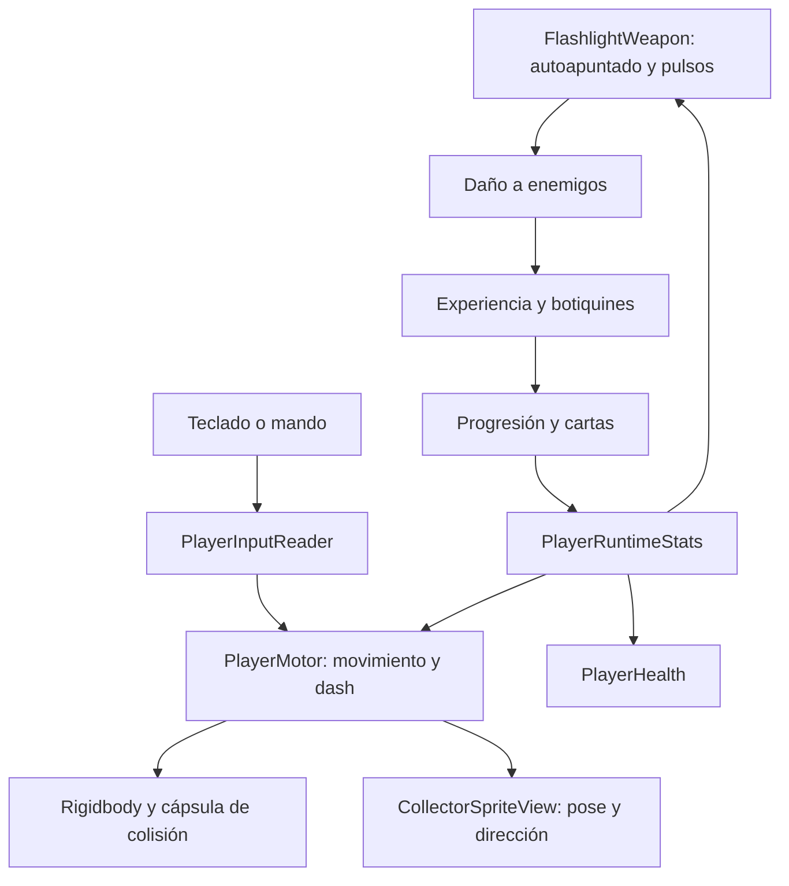

# Cómo funciona el jugador de EchoScrap

Esta guía describe el código y los assets actuales de `CombatArena`. Los valores
indicados son los valores base guardados; las cartas pueden modificarlos durante
la partida. No describe funcionalidades futuras del GDD.

## Un jugador, varios sistemas

La instancia llamada `Player` de la escena usa `CombatPlayer.prefab`, una variante
de `Player.prefab`. El prefab base aporta locomoción, controles y física; la
variante añade combate y la presentación del Coleccionista.

Un **GameObject** es un objeto de la escena. Sus **componentes** le dan funciones.
El **prefab** guarda una configuración reutilizable de esos objetos y componentes.
El dibujo del personaje es una parte de este conjunto.

`CombatGameBootstrap` conecta estos sistemas al iniciar la escena: jugador,
sesión, enemigos, recogibles, progresión, cámara e interfaz. Los sistemas externos
al personaje no tienen que estar todos dentro del objeto `Player` en la jerarquía.

## Controles y movimiento

`PlayerInputReader` lee el asset `PlayerControls.inputactions`. Cada instancia usa
su propia copia de las acciones para no modificar el asset compartido.

| Acción | Teclado | Mando |
| --- | --- | --- |
| Moverse | WASD o flechas | Stick izquierdo o cruceta |
| Dash | Espacio | Botón inferior, A en Xbox / cruz en PlayStation |
| Pausa | Escape | Start/Menu |

El vector de movimiento se limita a longitud 1: las diagonales no dan velocidad
extra. Con stick analógico se puede pedir menos velocidad. Al perder foco, morir
o abrir una pausa, se suprime la entrada. Confirmar una carta no produce un dash
accidental al volver al combate: se exige soltar el botón correspondiente.

`PlayerMotor` mueve un `Rigidbody` sobre el plano XZ. X y Z son las direcciones
del suelo; Y es la altura. El Rigidbody es dinámico, tiene gravedad desactivada,
altura bloqueada y rotaciones físicas bloqueadas. La cápsula base tiene radio
0,5 y altura 2 unidades. La interpolación suaviza su presentación entre pasos.

| Parámetro | Valor base |
| --- | ---: |
| Velocidad | 8 unidades/s |
| Aceleración | 80 unidades/s² |
| Frenado | 70 unidades/s² |
| Giro del sistema de orientación visual | 720°/s |
| Paso físico configurado | 0,02 s, 50 pasos/s |

El motor calcula una velocidad deseada y se aproxima a ella con aceleración o
frenado. No teletransporta el Transform en cada cuadro: PhysX resuelve las
colisiones del cuerpo. A velocidad máxima tarda aproximadamente 0,1 s en acelerar
y 0,11 s en frenar, sujetos a los pasos físicos.

La cápsula decide las colisiones y la zona del jugador que recibe daño. La capa,
el pico y el farol del dibujo pueden sobresalir de ella: el contorno de píxeles no
se utiliza como collider.

## Dash

El dash base va a 22 unidades/s durante 0,15 s: recorre aproximadamente 3,3
unidades si no choca. Su recarga de 1 s empieza al terminar el dash.

Usa la dirección de movimiento al iniciarse; estando quieto utiliza la última
dirección lógica del motor. La dirección queda fijada durante ese dash. El último
paso puede usar una fracción de velocidad para respetar la duración de 0,15 s.

Durante el dash cambia de la capa física `Player` a `PlayerDash` y es invulnerable.
Puede atravesar cuerpos enemigos, incluidos Coloso y Gólgora; sigue colisionando
con suelo, paredes y obstáculos. Un choque frontal con un muro genera una única
reacción y chispa durante ese dash.

Las pulsaciones durante el dash o su recarga se descartan: no se guarda una orden
para ejecutarla automáticamente cuando vuelva a estar disponible. La muerte y el
reinicio cancelan el dash y restauran la capa física.

`PlayerDashPresentation` muestra hasta tres estelas simultáneas de 0,12 s, un
anillo al iniciar y la chispa de choque. Las estelas guardan el cuadro y posición
capturados y se reutilizan mediante un pool.

## Linterna automática y apuntado

`FlashlightWeapon` ataca automáticamente. Busca al enemigo vivo más cercano
dentro de su alcance, considerando también el radio del enemigo. Si no hay
objetivo, orienta el arma según el movimiento o la última dirección del jugador.
El apuntado gira hasta 720°/s y tiene un pivote independiente del cuerpo.

La dirección del **sprite** se elige por el movimiento; la dirección del **arma**
se elige por el autoapuntado. Por ello puedes caminar hacia un lado mientras el
haz apunta a un enemigo situado en otro. Esta separación está implementada en la
lógica; el farol dibujado forma parte de cada pose del personaje.

| Parámetro | Valor base |
| --- | ---: |
| Alcance | 7 unidades |
| Apertura total del cono | 60° |
| Daño por pulso | 3,75 |
| Pulsos por ráfaga | 4 |
| Intervalo entre pulsos | 0,2 s |
| Descanso tras el cuarto pulso | 0,4 s |
| Impulso del cuarto pulso | 10 |

En una ráfaga que empieza en el tiempo 0, los pulsos ocurren en 0,2 / 0,4 / 0,6 /
0,8 s. La siguiente ráfaga empieza en 1,2 s. Si los cuatro pulsos aciertan sobre
un objetivo sin mitigación ni críticos, son 15 de daño por ciclo y 12,5 de daño/s
en promedio sostenido.

Cada pulso puede alcanzar a varios enemigos dentro del cono y golpea una sola
vez a cada objetivo, aunque tenga varios colliders. La comprobación es geométrica
en XZ e incluye el radio del objetivo cerca del borde. Actualmente atraviesa
obstáculos: no hace una prueba de línea de visión contra paredes.

Los parámetros se capturan al empezar cada ráfaga. Una mejora adquirida a mitad
de la ráfaga se aplica a la siguiente, conservando la coherencia de los cuatro
pulsos. El calendario usa tiempos acumulados para limitar la deriva con los FPS.

Los cuatro indicadores bajo los pies representan los pulsos de la ráfaga.
Actualmente no hay un recurso de combustible que se consuma al atacar.

## Luz, haz y daño cumplen funciones distintas

`FlashlightWeapon` decide qué enemigos reciben daño. `FlashlightPresentation`
reproduce destellos, indicadores y chispas siguiendo los eventos del arma.

`FlashlightSpotLight` es la luz 3D que ilumina el entorno. `OilLanternVolume`
añade el resplandor local cálido del farol y un volumen visible para el haz. El
resplandor sigue la posición del farol dibujado. La llama 3D provisional está
oculta en este personaje.

`Prototype coverage outline` es un GameObject con `LineRenderer` para el contorno
de cobertura del prototipo. Está oculto en la presentación actual. No calcula
daño ni emite luz. `Refactor Flashlight View` conserva parte del código visual
importado del prototipo; no representa otro jugador.

Cambiar la intensidad de una luz o la opacidad del haz no cambia por sí mismo el
daño. El daño depende de las estadísticas y comprobaciones del arma.

## Salud y recepción de daño

El jugador empieza con 100 de salud. `PlayerHealth` procesa cada golpe en este
orden:

1. Invulnerabilidad por dash o protección tras un golpe.
2. Tirada de evasión.
3. Tirada de bloqueo.
4. Reducción por armadura.
5. Pérdida efectiva de salud.

Un golpe que realmente quita salud abre 0,4 s de protección. Una evasión no abre
esa ventana ni reproduce la reacción de haber perdido vida. Un bloqueo reduce
el golpe un 50 %; la armadura se aplica después. Por ejemplo, un golpe de 20 con
bloqueo y 30 % de armadura termina quitando 7: `20 × 0,5 × 0,7`.

Armadura, evasión, bloqueo y probabilidad de crítico empiezan en 0 %. El código
admite esos atributos, con límites de 60 % / 35 % / 50 % para las tres defensas.
El multiplicador crítico base es ×1,75. Óptica precisa y Ojo aumentan la
probabilidad crítica; Calibración aumenta su multiplicador y Blindaje añade
armadura porcentual y salud máxima. Los límites defensivos se mantienen.

La reacción al daño incluye flash y desplazamiento visual breve. El hit-stop
retiene la pose local; el cuerpo físico continúa su simulación. El HUD puede
mostrar salud inmediata, una franja de daño reciente, borde de pantalla y un
indicador de la dirección del golpe. La curación se limita a la salud máxima y
no revive a un personaje que ya murió.

## Experiencia, botiquines y cartas

`CombatPickupPool` crea y reutiliza los recogibles. Dentro del radio magnético
base de 2,5 unidades empiezan a acercarse a 12 unidades/s. Una vez atraídos siguen
acercándose aunque el jugador se aleje del radio inicial. La recogida se resuelve
por distancia. La XP cercana puede agruparse sin perder su valor.

El botiquín Apollo usa su sprite y normal map de 32×32, iluminación de la escena
y sombra de contacto. Conserva la flotación, atracción y curación del sistema.
Cura 15 de base. Si se recoge con la salud completa se consume igualmente y la
curación efectiva es cero; no pasa a un inventario.

El jugador empieza en nivel 1. Los primeros requisitos de XP son 100, 150, 225 y
338; cada siguiente requisito sale de multiplicar el anterior por 1,5 y redondear.
Cada nivel añade una elección. Si una recogida concede varios niveles, las
elecciones se acumulan y se resuelven sin reactivar el combate entre ellas.

El draft pausa el juego y ofrece hasta tres cartas distintas que todavía puedan
mejorarse. Las rarezas usan pesos N=60, R=25, SR=12 y SSR=3 entre las categorías
disponibles; no son probabilidades fijas de cada carta individual.

| Carta | Efecto | Niveles máximos |
| --- | --- | ---: |
| Lente de Cuarzo Reforzado | +1 de alcance y +10° de apertura por nivel | 5 |
| Balasto de Alta Frecuencia | +15 % de velocidad de ataque por nivel; acelera pulsos y descanso | 5 |
| Foco Sobrecargado | −20° una vez; daño ×1,5 / ×1,8 / ×2,2 y empuje adicional 8 / 14 / 20 | 3 |
| Hiper-Rayo Solar | Alcance base 14, daño ×2,5, sin descanso entre ráfagas | 1 |
| Servomotores de Evasión | Recarga del dash −10 % y velocidad +8 % por nivel | 5 |
| Aleación Bio-Compuesta | +20 de salud máxima y cura inmediata de 15 por adquisición | 5 |
| Núcleo Supermagnético | +2 de radio magnético por nivel | 5 |
| Suministro Médico de Emergencia | Mejora aparición de botiquines y curación a 18 / 21 / 25 | 3 |

El modo solar conserva cuatro pulsos y el empuje del cuarto. La lente se suma al
alcance base solar. Las bonificaciones por niveles del balasto y servomotores
usan las fórmulas aditivas de `PlayerRuntimeStats`, sin multiplicarse
repetidamente unas por otras.

## Sprite y animaciones

El Coleccionista tiene 108 cuadros de 64×64 y 16 clips: Idle, Walk, Dash y Death
en cuatro direcciones. Por dirección hay 8 cuadros de Idle, 8 de Walk, 3 de Dash
y 8 de Death. Dash dura 0,15 s; Death dura 0,94 s. Idle y Walk forman bucles.

`CollectorSpriteView` lee la velocidad física, estado de dash y salud para elegir
el clip. La marcha adapta su ritmo a la velocidad. Al detenerse conserva la
última vista; las diagonales usan histéresis para no alternar continuamente entre
dos direcciones. La fase se conserva al cambiar de vista dentro del mismo estado.

La implementación usa un `MeshRenderer` sobre un plano vertical y cambia el
rectángulo UV del atlas. No necesita una textura por cuadro ni un Animator
Controller para estos clips. El archivo de datos guarda coordenadas y duraciones.

El plano mantiene orientación fija en XY y proporción vertical fija de 1,6,
con escala de referencia 1. Se retiraron las compensaciones que lo hacían verse
siempre frontal a la cámara. El pie queda anclado al suelo y se ajusta a una
cuadrícula de pantalla. El tamaño del dibujo no modifica la cápsula física.

El normal map describe direcciones de superficie por píxel para responder a la
luz; no convierte la máscara o la capa en geometría 3D. El material recibe el
ambiente/probes, la luz direccional y las luces locales de Unity. La sombra de
contacto y una proyección de la silueta ayudan a leer el apoyo sobre el piso. La
proyección está preparada para el suelo plano de esta arena.

Las deformaciones procedurales de squash/tilt del prototipo se omiten para este
sprite: sus poses ya están dibujadas. Se conservan flash y recoil. La pausa
congela los cuadros; Death puede terminar con tiempo no escalado tras la derrota.

## Cámara, pausas y reinicio

La cámara Cinemachine sigue la raíz física. Su anticipación usa velocidad de
movimiento y puede adelantarse hasta 1,2 unidades; el autoapuntado no decide ese
desplazamiento. Las sacudidas tienen prioridades: se utiliza la más fuerte en
lugar de sumar todos los impactos. Hay ajustes de intensidad y efectos reducidos.

`CombatSession` y `GameplayClock` controlan pausas manuales, draft, pérdida de
foco y fin de partida. Cerrar una causa de pausa no elimina las demás. Al perder
foco normalmente se requiere reanudar de forma explícita.

Al morir se desactiva la cápsula, se suprime la entrada, se cancela el dash, se
detiene el motor y deja de disparar la linterna. La sesión resuelve la derrota y
pausa la simulación. Si jugador y Gólgora mueren en el mismo paso prevalece la
derrota.

`ResetRun` limpia enemigos, peligros y recogibles activos, devuelve al jugador a
su posición inicial, restaura salud y estadísticas base, reinicia XP, cartas y
temporizadores, y vuelve a sincronizar cámara, arma, sprite y HUD. Reutiliza los
sistemas y pools existentes, sin necesitar recargar toda la escena.

Combate y presentación disponen de flujos pseudoaleatorios separados. Cambiar
partículas o sacudidas no consume las tiradas reservadas para críticos, drops y
ofertas de cartas.

## Dónde editar cada parte

| Lo que quieres cambiar | Archivo o recurso |
| --- | --- |
| Teclas y botones | `Assets/_Project/Settings/PlayerControls.inputactions` |
| Velocidad, aceleración y frenado | `Assets/_Project/Settings/PlayerLocomotion.asset` |
| Salud, defensa, dash y linterna base | `Assets/_Project/Settings/PlayerCombat_Default.asset` |
| Fórmulas de las mejoras | `Assets/_Project/Scripts/Core/PlayerRuntimeStats.cs` |
| Ofertas, nombres y límites de cartas | `Assets/_Project/Scripts/Combat/UpgradeCatalog.cs` |
| Movimiento físico | `Assets/_Project/Scripts/Player/PlayerMotor.cs` |
| Golpes de la linterna y autoapuntado | `Assets/_Project/Scripts/Combat/FlashlightWeapon.cs` |
| Salud y mitigación | `Assets/_Project/Scripts/Combat/PlayerHealth.cs` |
| Recogibles y curación | `Assets/_Project/Scripts/Combat/CombatPickupPool.cs` |
| Elección de cuadros y posición del sprite | `Assets/_Project/Scripts/Combat/CollectorSpriteView.cs` |
| Personaje editable en Aseprite | `ArtSource/Characters/Coleccionista/Coleccionista_Apollo.aseprite` |
| Atlas y normales activos del jugador | `Assets/_Project/Art/Characters/Coleccionista/` |
| Clips y mallas activos del jugador | `Assets/_Project/Art/Characters/Coleccionista/Data/` |
| Botiquín editable en Aseprite | `ArtSource/Items/Botiquin/Botiquin_Apollo.aseprite` |
| Texturas activas del botiquín | `Assets/_Project/Art/Items/Botiquin/` |

Para actualizar las exportaciones del jugador, usar **EchoScrap > Art > Connect
Collector To Player**. Para el botiquín, **EchoScrap > Art > Connect Medkit Sprite**.
Estas operaciones preparan sus assets sin reconstruir la arena.
